<div align="center">

# 📦 LogistiKI ERP
### **AI-First Autonomous WMS & Zero-Paper Delivery Note Platform**

[](https://www.python.org/)
[](https://www.docker.com/)
[](https://docs.pydantic.dev/)
[](https://ai.google.dev/)
[](https://github.com/)
[](https://github.com/)

**Entwickelt von Davide Carrieri — Simbio Ecosystem**  
*Intelligente Lagerautomatisierung, Wareneingang mit multimodaler KI und lückenlose e-CMR Quittierung auf jedem Smartphone.*

---

</div>

## 📌 Executive Summary

**LogistiKI ERP** ist eine moderne, hochgradig autonome WMS- und Logistikplattform (Warehouse Management System), die speziell für mittelständische Industrieunternehmen, Kontraktlogistiker und Großhändler entwickelt wurde. 

Sie löst die drei größten Ineffizienzen in der traditionellen Lagerverwaltung:
1. **Manuelle Erfassung von Papier-Lieferscheinen** (Tippfehler, Zeitverlust von 12–15 Min. pro Beleg).
2. **Suboptimale Regalplatzzuweisung** (fehlende Berücksichtigung von Gewicht, Ergonomie und Gangdistanzen).
3. **Papierverschwendung im Warenausgang** (hunderte gedruckte Begleitpapiere, die verloren gehen oder unleserlich sind).

Mit LogistiKI werden Lieferscheine **in unter 2 Sekunden digitalisiert**, automatisch validiert, in ein 3×3-Regallager (A/B/C) nach strengen FIFO- und Ergonomie-Kriterien zugewiesen und im Warenausgang über ein digitales **Fahrer-Totem mit QR-Code** papierlos quittiert.

---

## 🚀 Kernfunktionen (Core Features)

### 1. Inbound OCR & Multimodale KI-Erfassung
* **Dual-Tier Extraktion:** Native PDF-Textanalyse (`pypdf`) kombiniert mit hochpräziser multimodaler Bilderkennung (**Google Gemini 2.5 Flash / Vision OCR**).
* **Pydantic-AI Schema-Validierung:** Garantiert 100% typsichere JSON-Strukturen für Lieferanten, Lieferschein-Nummern, Bestelldaten und Positionslisten.
* **Visuelle Beleg-Verifikation:** Interaktive Dokumentenvorschau mit farblichen Bounding-Boxen und Zuverlässigkeitsmetriken (99.8% Match).
* **Entfernen (X) & Quick-Upload:** Schnelles Leeren der Ansicht und Sofort-Upload eigener PDF-Dateien aus lokalen Ordnern für flüssige Vorführungen.

### 2. Intelligentes Slotting & Human-in-the-Loop
* **Automatisierte Fachlogik:**
  * **Regal A (A-01-01 bis A-01-03):** Schnelldreher & Arbeitsschutz nah an Tor 1.
  * **Regal B (B-01-01 bis B-01-03):** Ergonomie-Zone auf Greifhöhe $h=1.10\,\text{m}$.
  * **Regal C (C-01-01 bis C-01-03):** Schwerlast-Bodenlager für DIN-Normteile, Gabelstapler & Sperrgut.
* **Dynamische Kapazitätsüberwachung:**
  * 🔴 **B-01-02 (Voll belegt):** Physikalisch gesperrt, Buchung wird automatisch abgewiesen.
  * 🟠 **C-01-02 (Teilbelegt / Zu klein):** Warnung vor Überhanggefahr, Zuweisung verlangt größeres Fach.
  * 🔵 **Freie Fächer:** Ein-Klick manuelle Zuweisung mit Echtzeit-Aktualisierung der SVG-Regalzeichnung.

### 3. Echtzeit-Industrieetikett (100 × 150 mm PDF)
* Generierung normgerechter VDA/DIN-Warenanhänger mit ReportLab.
* Dynamischer QR-Code (`ARTIKEL_NR|MENGE`), FIFO-Datum und Lagerplatz-Zuweisung.
* Ein-Klick Druckansicht im Browser.

### 4. E-Mail Benachrichtigung & Simulation
* Integrierter E-Mail-Modal-Dialog mit Sendungszusammenfassung und automatischen PDF-Anhängen.
* **Simulierter SMTP-Versand:** Ideal für Video-Demos und Kundengespräche mit Echtzeit-Bestätigung.
* **Mailto-Schnittstelle:** Direkte Übergabe an lokale Mail-Clients (Outlook, Thunderbird).

### 5. Outbound Paperless Totem & Mobile e-CMR
* **Zero-Paper Fahrer-Totem:** Generiert für jeden Kommissionierauftrag ein digitales Begleitdokument.
* **Universeller Smartphone-Scan:** Fahrer und Spediteure scannen den Totem-QR-Code mit jedem Smartphone (iOS/Android) — ohne App-Installation.
* **Touch-Quittierung:** Digitale Unterschrift direkt auf dem Handydisplay mit Revisionsnachweis und Archivierung.
* **Mehrsprachige Transparenz:** Automatische Browserübersetzung ermöglicht internationalen Fahrern die Anzeige in ihrer Muttersprache.

---

## 🏗️ Architektur & Pipeline

```mermaid
flowchart TD
    subgraph Inbound ["1. WARENEINGANG"]
        A["PDF / Papier-Lieferschein"] --> B["Multimodal Vision / Gemini 2.5 Flash"]
        B --> C["Pydantic-AI Schema Validation"]
        C --> D["KI-Slotting Heuristik (Regale A, B, C)"]
        D --> E{"Human-in-the-Loop Override?"}
        E -- Ja --> F["Manuelle Platzwahl"]
        E -- Nein --> G["Automatische Freigabe"]
        F --> H["ERP Buchung & Bestandserhöhung"]
        G --> H
        H --> I["PDF-Etikett 100x150 mm & E-Mail Alert"]
    end

    subgraph Outbound ["2. WARENAUSGANG (ZERO-PAPER)"]
        J["Kommissionierung Auftrag"] --> K["Digitaler Lieferschein (DB)"]
        K --> L["Dynamisches Totem QR-Code"]
        L --> M["Smartphone Scan (Spediteur / Fahrer)"]
        M --> N["Mobile Webansicht (e-CMR)"]
        N --> O["Digitale Touch-Unterschrift & Status 'Geliefert'"]
    end
```



---

## 🛠️ Technologie-Stack

| Komponente | Technologie | Zweck |
| :--- | :--- | :--- |
| **Backend** | Python 3.12, Flask, Flask-CORS | REST API & Webserver |
| **KI / Multimodal** | Google Gemini 2.5 Flash, Pydantic-AI | Dokumentenanalyse & Validierung |
| **OCR Fallback** | Tesseract OCR, PyPDF, PyMuPDF | Lokale Textextraktion |
| **Datenbank** | SQLite3 (Audit-Trails, Artikel, Buchungen) | Leichtgewichtige, transaktionssichere DB |
| **Dokumentenerzeugung** | ReportLab, Pillow, QRCode | Generierung von 100×150 mm Etiketten & QR-Codes |
| **Frontend** | HTML5, Tailwind CSS, Material Symbols | Responsives Enterprise-Dashboard |
| **Containerisierung** | Docker, Docker Compose | Reproduzierbares Deployment in Sekunden |

---

## ⚡ Schnellstart (Quickstart)

### Option A: Start mit Docker Compose (Empfohlen)

1. Repository klonen:
   ```bash
   git clone https://github.com/carrieri/logistiki-erp.git
   cd logistiki-erp
   ```

2. Umgebungsvariablen anlegen:
   ```bash
   cp .env.example .env
   ```
   *Trage deinen Google Gemini API Key in `.env` ein:*
   ```env
   GEMINI_API_KEY=dein_gemini_api_key_hier
   ```

3. Container starten:
   ```bash
   docker compose up -d --build
   ```

4. Öffne im Browser:
   $$\mathbf{http://localhost:5055}$$

---

### Option B: Lokale Installation mit Python

1. **Python 3.12** sicherstellen und virtuelles Environment erstellen:
   ```bash
   python -m venv venv
   # Windows:
   venv\Scripts\activate
   # Linux/macOS:
   source venv/bin/activate
   ```

2. Abhängigkeiten installieren:
   ```bash
   pip install -r requirements.txt
   ```

3. Konfiguration einrichten:
   ```bash
   cp config.example.json config.json
   ```
   *Füge deinen API Key in `config.json` ein oder setze `export GEMINI_API_KEY="dein-key"`.*

4. Backend starten:
   ```bash
   python app.py
   ```

5. Rufe die Anwendung auf:
   ```
   http://localhost:5055
   ```

---

## 📁 Projektstruktur

```
logistiki_erp/
├── agent/                  # KI-Agent & Geschäftslogik (Pydantic-AI, Schemas, Etiketten)
│   ├── agent.py            # Gemini Multimodal Agent Workflow
│   ├── config.py           # Zentrale Konfigurationsverwaltung (Env + JSON)
│   ├── etikett.py          # PDF-Generierung für Industrie-Etiketten
│   ├── lager.py            # FIFO- und Regal-Slotting-Logik
│   ├── schemas.py          # Pydantic Modelle für typsichere Belege
│   └── textextract.py      # Dual-Engine PDF/Image Extraktor
├── db/                     # SQLite Datenbank & Seed-Skripte
│   ├── erp_demo.db         # Lokale Demodatenbank (ignoriert in Git)
│   └── init_db.py          # Schema-Initialisierung & Musterdaten-Seeder
├── muster/                 # Authentische Lieferschein-Muster (PDF, DOCX, JSON)
├── ocr/                    # OCR Hilfsfunktionen
│   └── extractor.py        # pypdf / Tesseract Fallback Engine
├── output/                 # Generierte Arbeitsergebnisse
│   └── etiketten/          # PDF-Lageretiketten (100x150 mm)
├── templates/              # Jinja2 / HTML5 Web-Oberflächen
│   ├── index.html          # Haupt-Dashboard (Inbound, Outbound, WMS, Analytics)
│   └── lieferschein_view.html # Responsive mobile Webansicht für Smartphone-Scan
├── .dockerignore           # Ausschlussregeln für saubere Docker-Images
├── .env.example            # Vorlage für Umgebungsvariablen
├── .gitignore              # Strenger Git-Schutz (Keys, VPS-IPs, Logs, Binaries)
├── Dockerfile              # Multi-Stage Produktions-Container
├── docker-compose.yml      # 1-Klick Startdefinition
├── requirements.txt        # Python Abhängigkeiten
└── app.py                  # Zentraler Flask Server & REST Endpunkte
```

---

## 🔒 Datenschutz & Sicherheit

* **Keine vertraulichen Daten im Repository:** `.gitignore` schließt `config.json`, `.env`, Server-IPs und persönliche SSH-Schlüssel strikt aus.
* **On-Premise Ready:** Kann vollständig innerhalb geschlossener Firmen-VPNs oder lokaler Werksnetzwerke betrieben werden.
* **Next-Gen Edge Pipeline (In Vorbereitung):** Zukünftige Unterstützung für **Microsoft Florence-2 (0.77B)** und **Qwen 2.5 (1.5B)** auf lokaler CPU für 100% Offline-Betrieb ohne jeglichen Cloud-Datentransfer.

---

## 👤 Autor & Kontakt

**Davide Carrieri**  
*AI & Logistics Systems Engineer — Simbio Ecosystem*  
Carrieri Logistik GmbH  
Waiblingen, Deutschland  
📧 `davide.carrieri@carrieri-logistik.de`

---
<div align="center">
<sub>LogistiKI ERP © 2026 Davide Carrieri. Alle Rechte vorbehalten.</sub>
</div>
